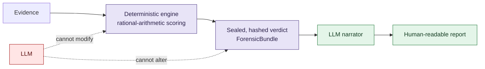

# VIGÍA — Academic Documentation (Research Archive)

**Language:** English · [Español](README_ES.md) · [Русский](README_RU.md) · [中文](README_ZH.md)

## What VIGÍA is

**VIGÍA is not a detector. It is a deterministic inference engine for digital-forensic *intentionality* analysis** — it quantifies the fracture between what evidence says and what evidence *should* say if the story it tells were true.

Current DFIR (Digital Forensics and Incident Response) tooling — EDR, SIEM, SOAR — is built to answer **"what happened?"**. VIGÍA is built to answer a different, prior question: **"why does the evidence look the way it looks, and whose interpretation does that serve?"** An attacker can fabricate or delete technical indicators (IoCs — Indicators of Compromise). What is much harder to fabricate away are the *semiotic* fractures that deliberate staging leaves behind: temporal incoherence, a significant absence where evidence should exist, suspiciously excessive "perfection" in an artifact, patterns of rhetorical manipulation, and violations of ordinary cooperative communication. VIGÍA formalizes these as **IoI — Indicators of Intent** — and treats them as first-class forensic signal, not narrative color.

| Traditional DFIR | VIGÍA |
|---|---|
| IoC (Indicator of Compromise) | IoI (Indicator of Intent) |
| Opaque ML confidence score, not explainable | Exact rational arithmetic (`Fraction`), every verdict reproducible and auditable |
| The LLM produces the verdict | The LLM narrates *after* the verdict is already sealed |
| Ignores the absence of expected evidence | Treats absence itself as a signal (Eco's "significant silence") |

### Architecture: keeping the LLM out of the decision



The verdict is computed and cryptographically sealed by a deterministic engine — no floating point, no opaque model — *before* any language model sees the evidence. The LLM's only job afterward is to turn an already-fixed verdict into prose for a human reader. It cannot move the needle, because by the time it is invoked there is no needle left to move. This single architectural choice is what lets VIGÍA's output aim at legal admissibility standards (Daubert-style: is the method testable, is the error process known, can another party independently verify the same inputs produce the same output) instead of asking a judge, a reviewer, or a reader to simply trust a model's confidence score.

### Why a sociologist finds this obvious — and why that matters

Here is the premise that motivates publishing this archive for researchers outside computer science: **what forensic analysts already do, informally, every day, is semiotics and abductive reasoning — they just don't call it that.** An experienced examiner looking at a disk image does not reason "P(malicious) = 0.87." They reason: *this process name is borrowed from a trusted one (a sign standing for something it isn't), this log is too clean to be the honest record of a system under real load (an absence that should be there and isn't), this story is internally consistent in a way that real human error never quite is.* That is Peirce's abduction — inference to the best explanation, building a hypothesis from a sign rather than deducing it from a rule. It is Eco's theory of overinterpretation and significant silence — knowing that what a text (or a filesystem) *doesn't* say can be as diagnostic as what it does. It is Grice's cooperative principle — noticing when a conversation (or a fabricated log) violates the implicit contract of honest communication. VIGÍA's contribution is not inventing this reasoning; it is **naming it, formalizing it, and making it computationally reproducible** instead of leaving it as an unexaminable instinct in one expert's head.

**Theoretical foundation:** Charles Sanders Peirce's triadic semiotics and abductive inference (Firstness/Secondness/Thirdness), Umberto Eco's theory of overinterpretation and significant silence, H. Paul Grice's cooperative principle and conversational maxims, and Dale Carnegie's taxonomy of manipulation patterns.

This is also the invitation behind publishing this archive: if you work in semiotics, philosophy of science, rhetoric, or social epistemology and have never looked at digital forensics, this is a live engineering domain that is already doing your theory — usually without knowing your theory's name — and could use your eyes on where the formalization is thin.

---

## Status of this archive

> **In maintenance, outdated.** This repository is a snapshot (copy-paste, no git history) of the `docs/academic/` folder from the main [`vigia-intent-analysis`](https://github.com/annatchijova/vigia-intent-analysis) repository, as it stood on **November 5, 2026**. VIGIA today has more than 500 Python modules and internal logic that has already moved past what several of these documents describe. They do not necessarily reflect the engine's current state — they are published as research material and theoretical reference, not as current technical documentation. This README deliberately leaves out installation steps and accuracy/evaluation figures (those live in the main repository) — the point of this archive is the reasoning model, not the pipeline's current benchmark.

### Why this separate repo exists

The main VIGIA repository moves fast, and its internal academic documentation (in `docs/academic/`) falls out of date between revisions. Rather than leaving those ~198 documents buried with no public access, they are split out here so they can be shared with researchers — in particular to keep promoting the application of Peircean semiotics (and Eco, Grice, and Carnegie) to forensic inference systems, which is VIGIA's theoretical core.

Over time this archive will be updated and expanded to better reflect the current 500+ module architecture and its rationale. For now it is a snapshot, not a living document.

## Start here

- **[VIGIA_RESEARCH_REPORT_EN.md](VIGIA_RESEARCH_REPORT_EN.md)** ([ES](VIGIA_RESEARCH_REPORT.md)) — the long-form research on why VIGIA has a reason to exist: the crisis in traditional DFIR, the EDR-as-black-box problem, and the proposal of a deterministic abductive-inference engine that separates evidence from LLM narrative. Originally generated by a Kimi K2 agent swarm, corrected and verified against the live repository by Claude — see the document header for full authorship detail.
- **[ACADEMIC_DOCS_MASTER_INDEX_EN.md](ACADEMIC_DOCS_MASTER_INDEX_EN.md)** — master index of the 192 documented modules, organized by area (`core`, `tools`, `sift`, `forensics`, `inference`, `pipeline`, `security`, `scripts`, `governance`, `specialized`). Also available in [Spanish](ACADEMIC_DOCS_MASTER_INDEX.md), [Russian](ACADEMIC_DOCS_MASTER_INDEX_RU.md), and [Chinese](ACADEMIC_DOCS_MASTER_INDEX_ZH.md).

## Structure

```
.
├── VIGIA_RESEARCH_REPORT_EN.md / .md       ← why VIGIA must exist (EN/ES)
├── ACADEMIC_DOCS_MASTER_INDEX_EN.md        ← master index (EN)
│                        .md / _RU.md / _ZH.md   ← same index in Spanish/Russian/Chinese
├── core/            — 38 docs — core pipeline, semiotics, signals, calibration
├── tools/           — 22 docs — CAIE, adversarial NLP, MITRE, patterns, EML
├── sift/            —  9 docs — MFT, prefetch, shellbag, registry, network, browser, memory
├── forensics/       —  5 docs — PDF, PKI, RFC3161, vision, chain of custody
├── inference/       —  5 docs — abductive reasoning, behavioral fingerprinting
├── pipeline/        —  4 docs — bundle, report, SIFT bridge, evidence registry
├── security/        —  4 docs
├── governance/       —  2 docs
├── specialized/      —  2 docs
├── scripts/          — 10 docs
├── root/             — 13 docs — root-level miscellany from the original corpus
└── unclassified/     — 78 docs — pending reclassification under the earlier scheme
```

Each document covers its module with a scientific note on the semiotics of Peirce, Eco, and Grice, and in several cases a multilingual technical glossary — see each file's header for its exact language coverage.

## License

**Apache License 2.0** — see [LICENSE](LICENSE). Same license as the main [`vigia-intent-analysis`](https://github.com/annatchijova/vigia-intent-analysis) repository, since this archive is part of that same project and using a different license would not make sense.

## Authorship

Same authorship regime as the VIGIA project: the architecture, theoretical decisions, and design belong to **Anna Tchijova**; several documents were drafted by a collective of AI models (Kimi K2, Claude, and others depending on the document — see each file's header) under her direction and corrected against the live repository. See [`AUTHORS.md`](https://github.com/annatchijova/vigia-intent-analysis/blob/main/AUTHORS.md) in the main repository for the full detail.

## Main repository

The code, tests, and current technical documentation live at [`github.com/annatchijova/vigia-intent-analysis`](https://github.com/annatchijova/vigia-intent-analysis). This repository is only the academic documentation archive.
