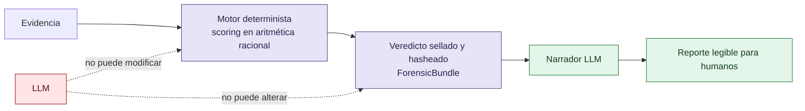

# VIGÍA — Documentación académica (archivo de investigación)

**Idioma:** Español · [English](README.md) · [Русский](README_RU.md) · [中文](README_ZH.md)

## Qué es VIGÍA

**VIGÍA no es un detector. Es un motor de inferencia determinista para el análisis de *intencionalidad* en forense digital** — cuantifica la fractura entre lo que dice la evidencia y lo que la evidencia *debería* decir si el relato que cuenta fuera cierto.

Las herramientas DFIR (Digital Forensics and Incident Response) actuales — EDR, SIEM, SOAR — están construidas para responder **"¿qué pasó?"**. VIGÍA está construido para responder una pregunta distinta, anterior: **"¿por qué la evidencia se ve como se ve, y a la interpretación de quién favorece eso?"** Un atacante puede fabricar o borrar indicadores técnicos (IoCs — Indicadores de Compromiso). Lo que es mucho más difícil de borrar son las fracturas *semióticas* que deja un montaje deliberado: incoherencia temporal, una ausencia significativa donde debería haber evidencia, una "perfección" sospechosamente excesiva en un artefacto, patrones de manipulación retórica, y violaciones de la comunicación cooperativa ordinaria. VIGÍA formaliza esto como **IoI — Indicadores de Intención** — y los trata como señal forense de primera clase, no como color narrativo.

| DFIR tradicional | VIGÍA |
|---|---|
| IoC (Indicador de Compromiso) | IoI (Indicador de Intención) |
| Score de confianza de ML opaco, no explicable | Aritmética racional exacta (`Fraction`), cada veredicto reproducible y auditable |
| El LLM produce el veredicto | El LLM narra *después* de que el veredicto ya está sellado |
| Ignora la ausencia de evidencia esperada | Trata la ausencia misma como señal ("silencio significativo" de Eco) |

### Arquitectura: mantener al LLM fuera de la decisión



El veredicto se calcula y se sella criptográficamente con un motor determinista — sin punto flotante, sin modelo opaco — *antes* de que cualquier modelo de lenguaje vea la evidencia. El único trabajo del LLM después es convertir un veredicto ya fijo en prosa para un lector humano. No puede mover la aguja, porque para cuando se lo invoca ya no queda aguja que mover. Esta única decisión arquitectónica es lo que permite que la salida de VIGÍA apunte a estándares de admisibilidad legal (al estilo Daubert: ¿el método es testeable?, ¿se conoce el proceso de error?, ¿puede otra parte verificar de forma independiente que los mismos insumos producen la misma salida?) en vez de pedirle a un juez, un revisor o un lector que simplemente confíe en el score de confianza de un modelo.

### Por qué a alguien de Ciencias Sociales esto le resulta obvio — y por qué eso importa

Esta es la premisa que motiva publicar este archivo para investigadores fuera de las ciencias de la computación: **lo que un analista forense ya hace, informalmente, todos los días, es semiótica y razonamiento abductivo — solo que no lo llama así.** Un examinador experimentado que mira una imagen de disco no razona "P(malicioso) = 0,87". Razona: *este nombre de proceso está tomado prestado de uno confiable (un signo que representa algo que no es), este log está demasiado limpio como para ser el registro honesto de un sistema bajo carga real (una ausencia que debería estar y no está), este relato es internamente consistente de una manera en que el error humano real nunca termina de serlo.* Eso es la abducción de Peirce — inferencia a la mejor explicación, construyendo una hipótesis a partir de un signo en vez de deducirla de una regla. Es la teoría de Eco sobre la sobreinterpretación y el silencio significativo — saber que lo que un texto (o un sistema de archivos) *no* dice puede ser tan diagnóstico como lo que sí dice. Es el principio cooperativo de Grice — notar cuándo una conversación (o un log fabricado) viola el contrato implícito de la comunicación honesta. El aporte de VIGÍA no es inventar este razonamiento; es **nombrarlo, formalizarlo y volverlo computacionalmente reproducible**, en vez de dejarlo como un instinto no examinable en la cabeza de un solo experto.

**Fundamento teórico:** la semiótica triádica y la inferencia abductiva de Charles Sanders Peirce (Primeridad/Segundidad/Terceridad), la teoría de la sobreinterpretación y el silencio significativo de Umberto Eco, el principio cooperativo y las máximas conversacionales de H. Paul Grice, y la taxonomía de patrones de manipulación de Dale Carnegie.

Esta es también la invitación detrás de publicar este archivo: si trabajás en semiótica, filosofía de la ciencia, retórica o epistemología social y nunca miraste el forense digital, este es un dominio de ingeniería activo que ya está haciendo tu teoría — generalmente sin saber cómo se llama tu teoría — y que podría necesitar tu mirada sobre dónde la formalización todavía es débil.

---

## Estado de este archivo

> **En mantenimiento, desactualizado.** Este repositorio es un volcado (copy-paste, sin historia de git) de la carpeta `docs/academic/` del repositorio principal [`vigia-intent-analysis`](https://github.com/annatchijova/vigia-intent-analysis), tal como estaba el **5 de noviembre de 2026**. VIGIA hoy tiene más de 500 módulos Python y una lógica interna que ya avanzó más allá de lo que describen varios de estos documentos. No reflejan necesariamente el estado actual del motor — se publican como material de investigación y referencia teórica, no como documentación técnica vigente. Este README deja afuera, a propósito, los pasos de instalación y las cifras de precisión/evaluación (eso vive en el repositorio principal) — el punto de este archivo es el modelo de razonamiento, no el benchmark actual del pipeline.

### Por qué existe este repo separado

El repositorio principal de VIGÍA avanza rápido y su documentación académica interna (en `docs/academic/`) queda desactualizada entre revisiones. En vez de dejar esos ~198 documentos enterrados sin acceso público, se separan acá para poder compartirlos con investigadores — en particular para seguir difundiendo la aplicación de la semiótica de Peirce (y de Eco, Grice y Carnegie) a sistemas de inferencia forense, que es el núcleo teórico de VIGIA.

Con el tiempo se va a actualizar y ampliar este archivo para que refleje mejor la arquitectura actual de +500 módulos y su razón de ser. Por ahora es una fotografía, no un documento vivo.

## Empezar por acá

- **[VIGIA_RESEARCH_REPORT.md](VIGIA_RESEARCH_REPORT.md)** ([EN](VIGIA_RESEARCH_REPORT_EN.md)) — la investigación extensa sobre por qué VIGIA tiene razón de existir: la crisis del DFIR tradicional, el problema de los EDR como cajas negras, y la propuesta de un motor de inferencia abductiva determinista que separa evidencia de narrativa LLM. Generado originalmente por un swarm de agentes Kimi K2, corregido y verificado contra el repositorio en vivo por Claude — ver cabecera del documento para el detalle de autoría.
- **[ACADEMIC_DOCS_MASTER_INDEX.md](ACADEMIC_DOCS_MASTER_INDEX.md)** — índice maestro de los 192 módulos documentados, organizados por área (`core`, `tools`, `sift`, `forensics`, `inference`, `pipeline`, `security`, `scripts`, `governance`, `specialized`). También disponible en [inglés](ACADEMIC_DOCS_MASTER_INDEX_EN.md), [ruso](ACADEMIC_DOCS_MASTER_INDEX_RU.md) y [chino](ACADEMIC_DOCS_MASTER_INDEX_ZH.md).

## Estructura

```
.
├── VIGIA_RESEARCH_REPORT.md / _EN.md       ← por qué VIGIA debe existir (ES/EN)
├── ACADEMIC_DOCS_MASTER_INDEX.md           ← índice maestro (ES)
│                        _EN.md / _RU.md / _ZH.md   ← mismo índice en inglés/ruso/chino
├── core/            — 38 docs — pipeline central, semiótica, señales, calibración
├── tools/           — 22 docs — CAIE, NLP adversarial, MITRE, patrones, EML
├── sift/            —  9 docs — MFT, prefetch, shellbag, registry, network, browser, memory
├── forensics/       —  5 docs — PDF, PKI, RFC3161, visión, cadena de custodia
├── inference/       —  5 docs — razonamiento abductivo, fingerprint conductual
├── pipeline/        —  4 docs — bundle, report, bridge SIFT, registro de evidencia
├── security/        —  4 docs
├── governance/       —  2 docs
├── specialized/      —  2 docs
├── scripts/          — 10 docs
├── root/             — 13 docs — misceláneos de nivel raíz del corpus original
└── unclassified/     — 78 docs — pendientes de reclasificar dentro del esquema anterior
```

Cada documento cubre su módulo con nota científica sobre la semiótica de Peirce, Eco y Grice, y en varios casos con glosario técnico multilingüe — ver el encabezado de cada archivo para su cobertura de idiomas exacta.

## Licencia

**Apache License 2.0** — ver [LICENSE](LICENSE). Misma licencia que el repositorio principal [`vigia-intent-analysis`](https://github.com/annatchijova/vigia-intent-analysis), porque este archivo es parte de ese mismo proyecto y usar una licencia distinta no tendría sentido.

## Autoría

Mismo régimen de autoría que el proyecto VIGIA: la arquitectura, las decisiones teóricas y el diseño pertenecen a **Anna Tchijova**; varios documentos fueron redactados por un colectivo de modelos de IA (Kimi K2, Claude, y otros según el documento — ver la cabecera de cada archivo) bajo su dirección y corregidos contra el repositorio en vivo. Ver [`AUTHORS.md`](https://github.com/annatchijova/vigia-intent-analysis/blob/main/AUTHORS.md) del repositorio principal para el detalle completo.

## Repositorio principal

El código, los tests y la documentación técnica vigente viven en [`github.com/annatchijova/vigia-intent-analysis`](https://github.com/annatchijova/vigia-intent-analysis). Este repositorio es solo el archivo de la documentación académica.
