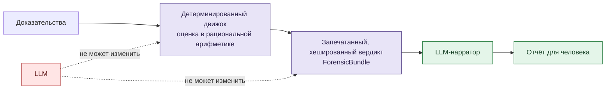

# VIGÍA — Академическая документация (исследовательский архив)

**Язык:** Русский · [English](README.md) · [Español](README_ES.md) · [中文](README_ZH.md)

## Что такое VIGÍA

**VIGÍA — это не детектор. Это детерминированный движок вывода для анализа *интенциональности* в цифровой криминалистике** — он измеряет разрыв между тем, что говорят доказательства, и тем, что они *должны* говорить, если бы рассказанная ими история была правдой.

Современные инструменты DFIR (Digital Forensics and Incident Response) — EDR, SIEM, SOAR — созданы, чтобы отвечать на вопрос **«что произошло?»**. VIGÍA создана, чтобы отвечать на другой, более ранний вопрос: **«почему доказательства выглядят именно так, и чьей интерпретации это служит?»** Злоумышленник может сфабриковать или удалить технические индикаторы (IoC — Indicators of Compromise, индикаторы компрометации). Но гораздо труднее устранить *семиотические* разломы, которые оставляет после себя намеренная постановка: временная несогласованность, значимое отсутствие там, где доказательство должно быть, подозрительно избыточная «идеальность» артефакта, паттерны риторического манипулирования и нарушения обычного кооперативного общения. VIGÍA формализует это как **IoI — Indicators of Intent, индикаторы намерения** — и рассматривает их как криминалистический сигнал первого класса, а не как нарративную окраску.

| Традиционный DFIR | VIGÍA |
|---|---|
| IoC (индикатор компрометации) | IoI (индикатор намерения) |
| Непрозрачная оценка достоверности ML, необъяснимая | Точная рациональная арифметика (`Fraction`), каждый вердикт воспроизводим и проверяем |
| LLM формирует вердикт | LLM формирует нарратив *после* того, как вердикт уже запечатан |
| Игнорирует отсутствие ожидаемых доказательств | Само отсутствие рассматривается как сигнал («значимое молчание» Эко) |

### Архитектура: удержание LLM вне принятия решения



Вердикт вычисляется и криптографически запечатывается детерминированным движком — без чисел с плавающей точкой, без непрозрачной модели — *до* того, как какая-либо языковая модель увидит доказательства. Единственная задача LLM после этого — превратить уже зафиксированный вердикт в текст для читателя-человека. Он не может повлиять на результат, потому что к моменту его вызова влиять уже не на что. Именно это архитектурное решение позволяет результатам VIGÍA стремиться к стандартам юридической допустимости (в духе Дауберта: проверяем ли метод, известен ли процесс ошибки, может ли другая сторона независимо убедиться, что те же входные данные дают тот же результат), а не просить судью, рецензента или читателя просто поверить показателю достоверности модели.

### Почему это очевидно для социального исследователя — и почему это важно

Вот предпосылка, которая мотивирует публикацию этого архива для исследователей за пределами computer science: **то, что криминалист-эксперт уже делает неформально, каждый день, — это семиотика и абдуктивное рассуждение, просто он не называет это так.** Опытный эксперт, глядя на образ диска, не рассуждает «P(вредоносно) = 0,87». Он рассуждает: *это имя процесса заимствовано у доверенного (знак, обозначающий нечто иное, чем он есть), этот лог слишком чист, чтобы быть честной записью системы под реальной нагрузкой (отсутствие там, где должно что-то быть), эта история внутренне последовательна так, как никогда до конца не бывает последовательна реальная человеческая ошибка.* Это абдукция Пирса — вывод к наилучшему объяснению, построение гипотезы из знака, а не выведение её из правила. Это теория Эко о сверхинтерпретации и значимом молчании — понимание того, что то, о чём текст (или файловая система) *умалчивает*, может быть столь же диагностично, как и то, что он говорит. Это кооперативный принцип Грайса — замечать, когда разговор (или сфабрикованный лог) нарушает негласный договор честного общения. Вклад VIGÍA — не в изобретении этого рассуждения, а в том, чтобы **назвать его, формализовать и сделать вычислительно воспроизводимым**, вместо того чтобы оставлять его непроверяемым инстинктом в голове одного эксперта.

**Теоретическая основа:** триадическая семиотика и абдуктивный вывод Чарльза Сандерса Пирса (Первичность/Вторичность/Третичность), теория сверхинтерпретации и значимого молчания Умберто Эко, кооперативный принцип и коммуникативные максимы Пола Грайса, а также таксономия манипулятивных паттернов Дейла Карнеги.

В этом же и приглашение, стоящее за публикацией этого архива: если вы занимаетесь семиотикой, философией науки, риторикой или социальной эпистемологией и никогда не смотрели на цифровую криминалистику — перед вами живая инженерная область, которая уже применяет вашу теорию, обычно не зная её названия, и которой не помешал бы ваш взгляд на то, где формализация пока слаба.

---

## Статус этого архива

> **В поддерживающем режиме, устарело.** Этот репозиторий представляет собой снимок (копипаст, без истории git) папки `docs/academic/` из основного репозитория [`vigia-intent-analysis`](https://github.com/annatchijova/vigia-intent-analysis) по состоянию на **5 ноября 2026 года**. Сегодня VIGIA насчитывает более 500 модулей на Python и внутреннюю логику, которая уже ушла дальше того, что описано во многих этих документах. Они не обязательно отражают текущее состояние движка — публикуются как исследовательский материал и теоретический справочник, а не как актуальная техническая документация. Этот README сознательно не включает шаги установки и показатели точности/оценки (они находятся в основном репозитории) — смысл этого архива в модели рассуждения, а не в текущем бенчмарке пайплайна.

### Почему существует этот отдельный репозиторий

Основной репозиторий VIGIA развивается быстро, и его внутренняя академическая документация (в `docs/academic/`) устаревает между ревизиями. Вместо того чтобы оставить эти ~198 документов похороненными без публичного доступа, они выносятся сюда, чтобы их можно было передать исследователям — в частности, чтобы продолжать продвигать применение семиотики Пирса (а также Эко, Грайса и Карнеги) к системам судебного (форензик) вывода, что составляет теоретическое ядро VIGIA.

Со временем этот архив будет обновляться и расширяться, чтобы лучше отражать текущую архитектуру из 500+ модулей и её обоснование. Пока это снимок, а не живой документ.

## С чего начать

- **[VIGIA_RESEARCH_REPORT.md](VIGIA_RESEARCH_REPORT.md)** ([EN](VIGIA_RESEARCH_REPORT_EN.md)) — развёрнутое исследование о том, зачем VIGIA вообще нужна: кризис традиционного DFIR, проблема EDR как «чёрного ящика» и предложение детерминированного движка абдуктивного вывода, который отделяет доказательства от нарратива LLM. Изначально сгенерировано роем агентов Kimi K2, проверено и скорректировано против живого репозитория Claude — детали авторства см. в заголовке документа.
- **[ACADEMIC_DOCS_MASTER_INDEX.md](ACADEMIC_DOCS_MASTER_INDEX.md)** — главный индекс 192 задокументированных модулей, сгруппированных по областям (`core`, `tools`, `sift`, `forensics`, `inference`, `pipeline`, `security`, `scripts`, `governance`, `specialized`). Также доступен на [английском](ACADEMIC_DOCS_MASTER_INDEX_EN.md), [испанском](ACADEMIC_DOCS_MASTER_INDEX.md) и [китайском](ACADEMIC_DOCS_MASTER_INDEX_ZH.md) языках.

## Структура

```
.
├── VIGIA_RESEARCH_REPORT.md / _EN.md       ← зачем нужна VIGIA (ES/EN)
├── ACADEMIC_DOCS_MASTER_INDEX.md           ← главный индекс (ES)
│                        _EN.md / _RU.md / _ZH.md   ← тот же индекс на английском/русском/китайском
├── core/            — 38 докум. — ядро пайплайна, семиотика, сигналы, калибровка
├── tools/           — 22 докум. — CAIE, состязательный NLP, MITRE, паттерны, EML
├── sift/            —  9 докум. — MFT, prefetch, shellbag, реестр, сеть, браузер, память
├── forensics/       —  5 докум. — PDF, PKI, RFC3161, зрение, цепочка хранения доказательств
├── inference/       —  5 докум. — абдуктивное рассуждение, поведенческий отпечаток
├── pipeline/        —  4 докум. — бандл, отчёт, мост к SIFT, реестр доказательств
├── security/        —  4 докум.
├── governance/       —  2 докум.
├── specialized/      —  2 докум.
├── scripts/          — 10 докум.
├── root/             — 13 докум. — прочее на корневом уровне исходного корпуса
└── unclassified/     — 78 докум. — ожидают реклассификации по прежней схеме
```

Каждый документ описывает свой модуль с научной заметкой о семиотике Пирса, Эко и Грайса, а в ряде случаев — с многоязычным техническим глоссарием; точный охват языков см. в заголовке каждого файла.

## Лицензия

**Apache License 2.0** — см. [LICENSE](LICENSE). Та же лицензия, что и у основного репозитория [`vigia-intent-analysis`](https://github.com/annatchijova/vigia-intent-analysis), поскольку этот архив — часть того же проекта, и использовать другую лицензию не имело бы смысла.

## Авторство

Тот же режим авторства, что и у проекта VIGIA: архитектура, теоретические решения и дизайн принадлежат **Анне Тчиховой**; ряд документов был написан коллективом моделей ИИ (Kimi K2, Claude и другие — см. заголовок каждого файла) под её руководством и выверен против живого репозитория. Полную информацию см. в [`AUTHORS.md`](https://github.com/annatchijova/vigia-intent-analysis/blob/main/AUTHORS.md) основного репозитория.

## Основной репозиторий

Код, тесты и актуальная техническая документация находятся в [`github.com/annatchijova/vigia-intent-analysis`](https://github.com/annatchijova/vigia-intent-analysis). Этот репозиторий — лишь архив академической документации.
