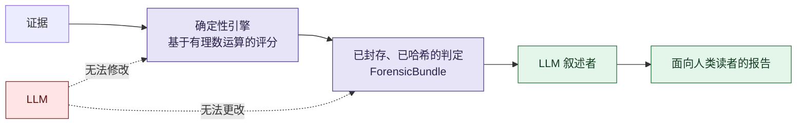

# VIGÍA — 学术文档(研究存档)

**语言:** 中文 · [English](README.md) · [Español](README_ES.md) · [Русский](README_RU.md)

## VIGÍA 是什么

**VIGÍA 不是一个检测器,而是一个用于数字取证中“意图性”分析的确定性推理引擎**——它量化的是证据所陈述的内容,与如果其所讲述的故事为真时证据“本应”陈述的内容之间的裂缝。

当前的 DFIR(数字取证与事件响应)工具——EDR、SIEM、SOAR——的设计目的是回答**“发生了什么?”**。而 VIGÍA 要回答的是一个不同的、更前置的问题:**“证据为什么呈现为现在这个样子,这种呈现又对谁的解释有利?”** 攻击者可以伪造或删除技术指标(IoC,入侵指标)。但更难被消除的是蓄意布置所留下的**符号学裂缝**:时间上的不连贯、本该存在却缺失的有意义的“沉默”、某个证物中可疑地过度“完美”、修辞操纵的模式,以及对普通合作性交流规则的违反。VIGÍA 将这些正式化为 **IoI——意图指标(Indicators of Intent)**——并将其视为一等的取证信号,而非仅仅是叙述上的点缀。

| 传统 DFIR | VIGÍA |
|---|---|
| IoC(入侵指标) | IoI(意图指标) |
| 不透明的机器学习置信度分数,无法解释 | 精确的有理数运算(`Fraction`),每个判定都可复现、可审计 |
| LLM 生成判定结果 | 判定结果被封存之后,LLM 才对其进行叙述 |
| 忽略本应存在却缺失的证据 | 将“缺失”本身视为一种信号(艾柯所谓的“有意义的沉默”) |

### 架构:将 LLM 排除在决策之外



判定结果由确定性引擎计算并以密码学方式封存——不使用浮点数,不使用不透明模型——且这一切都发生在**任何**语言模型看到证据**之前**。此后,LLM 唯一的工作就是把一个已经固定下来的判定转化为供人类读者阅读的文字。它无法左右结果,因为当它被调用时,已经没有可供撬动的空间了。正是这一个架构选择,使得 VIGÍA 的输出能够朝向司法可采性标准(类似 Daubert 标准:方法是否可检验?误差过程是否已知?另一方能否独立验证相同输入会得到相同输出?),而不是要求法官、审阅者或读者仅仅相信某个模型给出的置信度分数。

### 为什么一个社会科学背景的人会觉得这“显而易见”——以及这为什么重要

以下正是促使我们向计算机科学之外的研究者公开这份存档的出发点:**法医分析师日复一日已经在非正式地做的事情,本质上就是符号学与溯因推理——只是他们没有用这些名字来称呼它。** 一位经验丰富的鉴定人员查看磁盘镜像时,不会想“P(恶意)= 0.87”。他会这样推理:*这个进程名借用了一个可信进程的名字(一个符号在代表着它本身并不是的东西),这份日志干净得不像是一个在真实负载下运行的系统所留下的诚实记录(本该存在却缺失的东西),这个故事的内部一致性达到了真实的人为失误永远不会呈现出的那种程度。* 这正是皮尔士的溯因推理——从一个符号出发、推导出最佳解释式的假设,而不是从一条规则中演绎出结论。这也是艾柯关于过度诠释与有意义的沉默的理论——懂得一个文本(或一个文件系统)**没有**说出的内容,其诊断价值可能不亚于它说出的内容。这同样是格赖斯的合作原则——察觉一段对话(或一份伪造的日志)何时违反了诚实交流的隐含契约。VIGÍA 的贡献不在于发明这套推理方式,而在于**为其命名、使其形式化,并使其在计算上可复现**,而不是任其作为某一位专家脑海中无法被审查的直觉。

**理论基础:** 查尔斯·桑德斯·皮尔士的三元符号学与溯因推理(第一性/第二性/第三性)、翁贝托·艾柯关于过度诠释与有意义的沉默的理论、保罗·格赖斯的合作原则与会话准则,以及戴尔·卡耐基的操纵模式分类法。

这同时也是公开此存档背后的邀请:如果你从事符号学、科学哲学、修辞学或社会认识论研究,却从未关注过数字取证领域——这里正是一个活生生的工程领域,它已经在实践你的理论(通常并不知道你的理论叫什么名字),而且很需要你来审视一下,哪些地方的形式化工作还很薄弱。

---

## 本存档的状态

> **维护中,内容已过时。** 本仓库是主仓库 [`vigia-intent-analysis`](https://github.com/annatchijova/vigia-intent-analysis) 中 `docs/academic/` 文件夹在 **2026 年 11 月 5 日** 的快照(直接复制粘贴,不含 git 历史记录)。VIGIA 目前已拥有超过 500 个 Python 模块,其内部逻辑已经超越了这些文档中许多内容所描述的状态。它们不一定反映引擎当前的实际状态——发布它们是作为研究材料和理论参考,而非现行的技术文档。本 README 有意省略了安装步骤以及准确率/评估相关数据(这些内容在主仓库中)——这份存档的重点在于其推理模型,而不是流水线当前的基准测试结果。

### 为什么要设立这个独立仓库

VIGIA 主仓库迭代很快,其内部学术文档(位于 `docs/academic/`)在各次修订之间会变得过时。与其让这约 198 份文档被埋没、无法公开访问,不如把它们单独拆分到这里,以便分享给研究者——尤其是为了继续推广将皮尔士的符号学(以及艾柯、格赖斯和卡内基的理论)应用于取证推理系统,这正是 VIGIA 的理论核心。

随着时间推移,这个存档会被更新和扩充,以便更好地反映目前超过 500 个模块的架构及其设计理由。目前它只是一个快照,而非持续更新的文档。

## 从这里开始

- **[VIGIA_RESEARCH_REPORT.md](VIGIA_RESEARCH_REPORT.md)**([英文版](VIGIA_RESEARCH_REPORT_EN.md))——关于 VIGIA 存在之理由的长篇研究:传统 DFIR(数字取证与事件响应)所面临的危机、EDR 作为“黑箱”的问题,以及提出一个将证据与 LLM 叙述相分离的确定性溯因推理引擎。该文档最初由 Kimi K2 智能体集群生成,并由 Claude 对照实时仓库进行了核实与修正——完整的作者信息详见文档开头。
- **[ACADEMIC_DOCS_MASTER_INDEX_ZH.md](ACADEMIC_DOCS_MASTER_INDEX_ZH.md)**——192 个已记录模块的总索引,按领域分类(`core`、`tools`、`sift`、`forensics`、`inference`、`pipeline`、`security`、`scripts`、`governance`、`specialized`)。另有[英文版](ACADEMIC_DOCS_MASTER_INDEX_EN.md)、[西班牙文版](ACADEMIC_DOCS_MASTER_INDEX.md)和[俄文版](ACADEMIC_DOCS_MASTER_INDEX_RU.md)。

## 目录结构

```
.
├── VIGIA_RESEARCH_REPORT.md / _EN.md       ← VIGIA 存在之理由(ES/EN)
├── ACADEMIC_DOCS_MASTER_INDEX.md           ← 总索引(ES)
│                        _EN.md / _RU.md / _ZH.md   ← 同一索引的英/俄/中文版本
├── core/            — 38 篇文档 — 核心流水线、符号学、信号、校准
├── tools/           — 22 篇文档 — CAIE、对抗性 NLP、MITRE、模式识别、EML
├── sift/            —  9 篇文档 — MFT、prefetch、shellbag、注册表、网络、浏览器、内存
├── forensics/       —  5 篇文档 — PDF、PKI、RFC3161、图像分析、证据链
├── inference/       —  5 篇文档 — 溯因推理、行为指纹
├── pipeline/        —  4 篇文档 — 数据包、报告、SIFT 桥接、证据登记
├── security/        —  4 篇文档
├── governance/       —  2 篇文档
├── specialized/      —  2 篇文档
├── scripts/          — 10 篇文档
├── root/             — 13 篇文档 — 原始语料库根目录下的杂项内容
└── unclassified/     — 78 篇文档 — 按旧有分类方案尚待重新归类
```

每份文档都会就皮尔士、艾柯和格赖斯的符号学理论对其所述模块作出科学说明,部分文档还附有多语种技术术语表——各文件具体支持哪些语言,请参见该文件的文档头部说明。

## 许可证

**Apache License 2.0** —— 详见 [LICENSE](LICENSE)。与主仓库 [`vigia-intent-analysis`](https://github.com/annatchijova/vigia-intent-analysis) 使用相同的许可证,因为本存档是同一项目的一部分,采用不同的许可证并不合理。

## 作者署名

与 VIGIA 项目采用相同的署名规则:架构、理论决策与设计均归 **Anna Tchijova** 所有;其中多篇文档由一组 AI 模型(Kimi K2、Claude,以及视具体文档而定的其他模型——详见各文件文档头部)在她的指导下撰写,并对照实时仓库进行了核实与修正。完整细节请见主仓库中的 [`AUTHORS.md`](https://github.com/annatchijova/vigia-intent-analysis/blob/main/AUTHORS.md)。

## 主仓库

代码、测试以及现行有效的技术文档均位于 [`github.com/annatchijova/vigia-intent-analysis`](https://github.com/annatchijova/vigia-intent-analysis)。本仓库仅为学术文档的存档。
